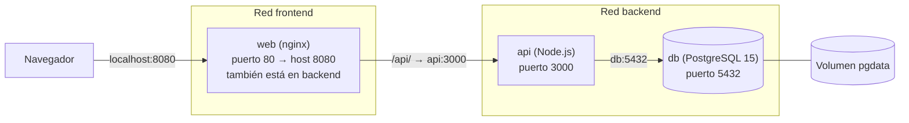

# Proyecto: Tres Contenedores Interconectados
Sistemas Operativos I · UMG — Gestor de Contactos (3 capas)

## Diagrama



- `web` hace proxy de `/api/` hacia `http://api:3000/` (por nombre de servicio).
- `api` se conecta a la BD con `DB_HOST=db`.
- Solo `web` está en `frontend`; `api` y `db` viven en `backend`.
- Los datos de PostgreSQL se guardan en el volumen `pgdata`.

## Pasos
```bash
cp .env.example .env        # credenciales fuera del código
docker compose up -d --build
docker compose ps
```
Abrir http://localhost:8080

## Comandos de evidencia
```bash
docker ps
docker network ls
docker network inspect tres-contenedores_backend
docker compose logs api
# Conectividad por nombre entre contenedores
docker exec proyecto_web wget -qO- http://api:3000/contactos
docker exec proyecto_api ping -c 2 db
# API directa desde el host
curl.exe -X POST localhost:3000/contactos -H "Content-Type: application/json" -d "{\"nombre\":\"Ana\",\"telefono\":\"5555-1234\"}"
curl.exe localhost:3000/contactos
```

## Prueba de persistencia
```bash
docker compose down        # borra contenedores, NO el volumen
docker compose up -d
curl.exe localhost:3000/contactos   # los datos siguen ahí
docker volume ls
# docker compose down -v  -> borra también el volumen
```
